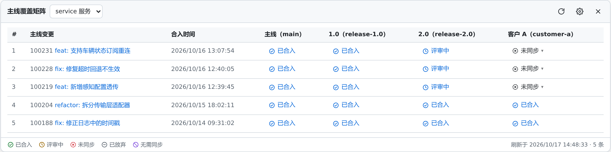

# Gerrit 主线覆盖矩阵

一个 Tampermonkey 用户脚本：在 Gerrit 页面上查看**主线分支的每一笔变更是否已同步到各个目标分支**，
并可以直接从页面发起 cherry-pick。

适合这样的工作流：团队在主线分支开发，按需把主线提交 cherry-pick 到多个发布/客户分支，
需要经常回答「这笔改动到 dev 分支了吗」。

## 功能

- **变更页右栏**：在 Cherry picks 下方嵌入「目标分支同步」区块，按目标分支列出 已合入 / 评审中 / 未同步。
- **覆盖矩阵**：浮动面板里一行一笔主线变更、一列一个目标分支，多个仓库可切换。
- **直接 cherry-pick**：点击「未同步」即可在 Gerrit 上创建对应的 cherry-pick 变更，
  结果直接显示在菜单里。冲突、`identical tree` 等失败原因原样透出。
- **无需同步标记**：某些提交本来就不需要同步到某分支，可以标记掉，避免一直显示未同步。
- **多仓库、多目标分支**：全部在界面里配置，支持从 Gerrit 分支列表筛选多选。
- **只读查询 + 网页登录态**：不保存任何凭据，不需要配置账号密码或 token。

## 安装

**一键安装**：[点此安装脚本](https://github.com/fuhailong1998/gerrit-branch-matrix/raw/master/gerrit-branch-matrix.user.js)

Tampermonkey 会弹出安装页，点「安装」即可。需要先装好
[Tampermonkey](https://www.tampermonkey.net/)。

如果点击后只显示源码而没有弹出安装页，在 Tampermonkey 管理面板里新建脚本，
把源码整个粘贴进去保存即可。

**手动安装**：打开 [`gerrit-branch-matrix.user.js`](gerrit-branch-matrix.user.js)，
点右上角「Raw」，全选复制后在 Tampermonkey 里新建脚本粘贴保存。

安装后点浏览器工具栏的 Tampermonkey 图标 →「**设置 Gerrit 地址**」，填写你的 Gerrit 地址
（含子路径，例如 `http://192.0.2.10/gerrit`）。之后打开该 Gerrit，右下角出现圆形图标即可使用。
不设置时，脚本会自动识别当前打开的 Gerrit 页面。

详细用法见 [USAGE.md](USAGE.md)。

## 工作原理

- 通过 Gerrit REST 的同源请求查询：
  - 主线最近 N 笔已合入变更（`/changes/?q=project:... branch:... status:merged`）。
  - 每个目标分支上是否存在对应 `Change-Id` 的变更，取其最优状态（已合入 > 评审中 > 已放弃）。
- cherry-pick 调用 `POST /changes/<号>/revisions/current/cherrypick`，使用网页的 `XSRF_TOKEN` 作为
  `X-Gerrit-Auth` 头，与 Gerrit 自己的前端完全一致。
- 仓库/分支配置和「无需同步」标记通过 `GM_setValue` 存在浏览器本地，可用面板的导入导出来备份或迁移。
- 只读页面结构，不改动 Gerrit 自身渲染；嵌入区块放在独立 Shadow DOM 内，样式沿用 Gerrit 的 CSS 变量。

## 限制

- 判断依据是 **Change-Id**。不经过 Gerrit 直接 push，或者多个提交被合并后一起同步的情况，
  会显示为「未同步」——后者可以手动标记为无需同步。
- 嵌入区块依赖 Gerrit 3.x 的页面结构（`gr-app → gr-app-element → gr-change-view → .relatedChanges`）。
  已在 Gerrit 3.10 上验证；大版本升级后如区块不出现，需要调整 `findRelatedColumn`。
- 配置只存本地浏览器，不做多端同步。
- 未在移动端验证。

## 许可

MIT
